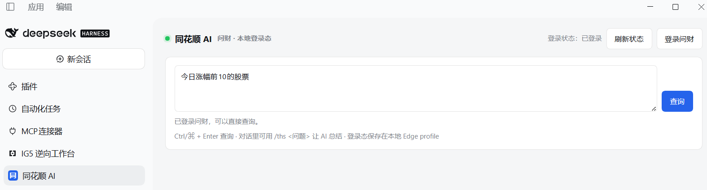

# dsh-ths-ai · 同花顺问财 DSH 插件

[](https://github.com/buyou-claw/dsh-ths-ai/actions/workflows/ci.yml)
[](LICENSE)

把**同花顺问财（iwencai）**接进 DeepSeek Harness（DSH）：右侧多一个「同花顺 AI」面板，对话里多一个 `/ths` 命令，模型手里多两个工具 `ths_query` / `ths_status`。

> **它不是 API，也不是 MCP。** 它复用你**本机已经登录的浏览器 profile**，像你本人一样打开问财页面读取结果。
> 因此没有 API Key、没有服务端、没有任何数据离开你的电脑 —— 代价是你的账号、你的登录态、你所在平台的使用协议，责任都在你这边。**使用前请先读 [合规与免责声明](docs/LEGAL.md)。**



---

## 目录

- [它能做什么](#它能做什么)
- [环境要求](#环境要求)
- [安装](#安装)
- [首次使用](#首次使用)
- [两种使用方式](#两种使用方式)
- [配置项](#配置项)
- [常见问题](#常见问题)
- [隐私与安全](#隐私与安全)
- [项目结构](#项目结构)
- [开发与测试](#开发与测试)
- [Roadmap](#roadmap)
- [许可](#许可)

---

## 它能做什么

| 能力 | 说明 |
|---|---|
| 右侧面板 | 输入自然语言问题 → 直接拿回问财表格；显示登录状态、可一键登录、可刷新状态 |
| `/ths <问题>` | 对话里让 AI 调用工具查问财，并把结果总结成「结论 + 精简表格 + 口径 + 异常项」，而不是甩一张原始表格 |
| `ths_query` 工具 | 模型可直接调用：`{"query": "最近一周涨幅最大的个股"}` |
| `ths_status` 工具 | 只读判断当前 profile 是否已登录（不猜、不编） |
| 状态缓存 | 状态检查要拉起一次浏览器（10–20 s），因此结果缓存 5 分钟并启动后台预热，面板打开基本秒回 |
| 查询节流 | 两次查询之间默认强制 ≥3 秒间隔，避免把问财打到限流 |

**它不是什么：**

- 不是行情数据源：没有内置数据、没有行情缓存，不保证数据完整或实时；
- 不是投资建议工具：结果来自问财页面，内容由 AI 生成，请自行甄别；
- 不绕过登录 / 验证码 / 付费墙，也不内置任何反检测隐身参数；
- 不承诺跨平台：**Windows + Edge 是实测路径**，其它平台见 [配置项](#配置项)。

## 环境要求

| 依赖 | 要求 | 说明 |
|---|---|---|
| DeepSeek Harness | `>= 0.2.0-rc.2` | 0.2.x 起 agent 工具必须声明 `output { schema, render }` |
| Node.js | `>= 20` | 用 DSH 自带运行时即可，无需单独安装 |
| 浏览器 | Edge（默认） | 走 Playwright `channel: 'msedge'`，用**系统已安装**的 Edge，不下载内核 |
| 账号 | 你自己的同花顺问财账号 | 登录在可见窗口里由你本人完成 |
| 平台 | Windows（实测） | macOS / Linux 见 `DSH_THS_BROWSER` |

> 只依赖 `playwright-core`（约 13 MB，不含浏览器二进制），`npm install` 不会触发浏览器下载。

## 安装

### 方式 A：一键脚本（Windows，推荐）

```powershell
# 1. 把仓库放到 DSH 插件目录
git clone https://github.com/buyou-claw/dsh-ths-ai "$env:USERPROFILE\.dsh\plugins\dsh-ths-ai"

# 2. 装依赖并接进 DSH 桌面端 profile
cd "$env:USERPROFILE\.dsh\plugins\dsh-ths-ai"
npm install --omit=dev
powershell -ExecutionPolicy Bypass -File install\install.ps1

# 3. 重启 DSH 桌面端
```

脚本做三件事：① 在 `~/.dsh/profiles/desktop/package.json` 登记依赖与 bundle（先备份为 `package.json.bak-ths-ai`）；② 建 `node_modules/dsh-ths-ai` 目录联接；③ 打印下一步。可重复运行（幂等）。

### 方式 B：手工（任何平台）

1. 把仓库放到 `~/.dsh/plugins/dsh-ths-ai`，执行 `npm install --omit=dev`；
2. 编辑 `~/.dsh/profiles/desktop/package.json`：
   ```json
   {
     "dependencies": { "dsh-ths-ai": "file:../../plugins/dsh-ths-ai" },
     "dsh": { "profile": { "bundles": [ "...原有项", "dsh-ths-ai" ] } }
   }
   ```
3. 建联接：Windows `New-Item -ItemType Junction -Path "$env:USERPROFILE\.dsh\profiles\desktop\node_modules\dsh-ths-ai" -Target "$env:USERPROFILE\.dsh\plugins\dsh-ths-ai"`；macOS/Linux 用 `ln -s`；
4. 重启 DSH。

完整步骤（含校验与卸载回滚）见 [docs/INSTALL.md](docs/INSTALL.md)。

### 验证安装

1. 右侧栏应出现「同花顺 AI」面板；
2. 对话里发 `/ths 今日涨幅前10的股票`，应直接返回结果；
3. 工具注册情况见 `~/.dsh/logs/dsh-ths-ai.log`：应有 `ths_query registered` / `ths_status registered`。

> 工具没出现？先看下面「常见问题」，90% 是 DSH 版本或没重启。

## 首次使用

1. 打开右侧「同花顺 AI」面板 → 点 **登录问财**；
2. 弹出的浏览器窗口里用**你自己的账号**完成登录；
3. **登录完成后关闭那个窗口**（登录态已写入本地 profile）；
4. 回面板点 **刷新状态**，出现「已登录」即可查询。

> 同一个 profile 同时只能被一个浏览器进程使用。登录窗口开着时不要查询，会报 profile 被占用。

## 两种使用方式

**面板**：随手查，结果直接渲染成表格。

**对话 `/ths`**：

```text
/ths 最新一周涨幅最大的个股
/ths 低市盈率且主力净流入的股票
/ths status          # 只看登录状态
```

AI 会调用 `ths_query` 取数，再按「结论 → 精简表格 → 口径 → 异常项（ST/新股/北交所/单日大跌但区间大涨）」组织回答，不编数据。

## 配置项

全部通过环境变量覆盖，**不设置时行为与默认完全一致**：

| 变量 | 默认 | 作用 |
|---|---|---|
| `DSH_THS_PROFILE_DIR` | `<插件目录>/profile` | 浏览器持久化配置目录。装到只读目录时改成可写路径 |
| `DSH_THS_BROWSER` | `msedge` | Playwright channel。macOS/Linux 可试 `chrome` / `chromium`（未实测，欢迎反馈） |
| `DSH_THS_WAIT_MS` | `12000` | 结果页渲染等待毫秒数。网络慢/表格空可上调 |
| `DSH_THS_STATUS_WAIT_MS` | `3500` | 状态检查页等待毫秒数 |
| `DSH_THS_MIN_INTERVAL_MS` | `3000` | 两次查询的最小间隔（节流） |
| `DSH_THS_LOG_DIR` | `~/.dsh/logs` | 诊断日志目录（`dsh-ths-ai.log`，超过 512 KB 自动清空） |
| `DSH_THS_NODE` | 自动探测 | 指定用哪个 node 跑子进程（默认用 DSH 自带运行时） |

## 常见问题

| 现象 | 最可能的原因 | 处理 |
|---|---|---|
| 面板能用，但模型说没有 `ths_query` 工具 | DSH 版本不匹配 / 未重启 | 确认 DSH `>= 0.2.0-rc.2`；重启桌面端；看 `~/.dsh/logs/dsh-ths-ai.log` |
| 登录状态一直「检查中…」很久 | 首次检查要拉起浏览器（10–20 s），之后走缓存 | 等一次即可；之后 5 分钟内秒回 |
| 提示「未登录」但明明登录过 | 查询与登录用的不是同一个 profile | 统一 `DSH_THS_PROFILE_DIR`；登录后关闭窗口再刷新状态 |
| `browser has been closed` / profile 被占用 | 登录窗口还开着，或并发查询 | 关掉登录窗口；不要并发 |
| 返回 `blocked` / 访问受限 | 触发问财限流或风控 | 调大 `DSH_THS_MIN_INTERVAL_MS`，过段时间再试 |
| 表格列为空 / 结构错乱 | 问财前端改版 | 带日志开 issue |
| macOS/Linux 报 browser not found | 默认 channel 是 `msedge` | `DSH_THS_BROWSER=chrome` 或 `chromium` |

完整排查树见 [docs/TROUBLESHOOTING.md](docs/TROUBLESHOOTING.md)。

**提 issue 请附**：DSH 版本、操作系统、`~/.dsh/logs/dsh-ths-ai.log` 相关片段、复现用问句。**不要贴 Cookie / 账号信息。**

## 隐私与安全

- 登录态（Cookie，含 `u_ukey`）只存在**本机** `profile/` 目录，插件不上传任何数据；`.gitignore` 已排除 `profile/`。
- 想彻底清除登录态：关掉 DSH → 删除 `profile/` 目录（下次重新登录）。
- 不要在 issue / 截图里暴露 Cookie、手机号、验证码。
- 安全问题的报告流程见 [SECURITY.md](SECURITY.md)。

## 项目结构

```text
dsh-ths-ai/
├── index.js            # 宿主侧：路由 /ths-ai/*、2 个 agent 工具、子进程桥、状态缓存
├── client.js           # 客户端侧：右侧「同花顺 AI」面板
├── config.mjs          # 运行期配置（目录 / 浏览器 channel / 等待时间 / 日志）
├── login.mjs           # 打开可见窗口让你本人登录
├── query.mjs           # 无头打开问财、抽取表格、输出 THS_RESULT
├── status.mjs          # 只读判断登录态、输出 THS_STATUS
├── cordis.patch.yml    # DSH bundle patch：注册插件
├── skills/ths/SKILL.md # /ths skill 指令（模型侧行为约束）
├── docs/               # 安装 / 排查 / 架构 / 合规
└── install/            # 一键安装与卸载脚本
```

细节见 [docs/ARCHITECTURE.md](docs/ARCHITECTURE.md)。

## 开发与测试

```bash
npm install --omit=dev
npm run check            # 6 个文件语法检查（CI 跑这个）
npm run verify:status    # 真实检查登录态（会拉起浏览器）
THS_QUERY="今日涨幅前10的股票" npm run verify:query   # 真实查询一次
```

CI 只做语法检查，不做联网测试（不在 CI 里使用任何账号）。改动问财选择器时请本地跑 `verify:query` 并附日志。

贡献流程见 [CONTRIBUTING.md](CONTRIBUTING.md)，Issue/PR 约定见 [AGENTS.md](AGENTS.md)，版本发布与市场提交见 [docs/PUBLISHING.md](docs/PUBLISHING.md)。

## Roadmap

- [ ] macOS / Linux 浏览器探测实测（当前靠 `DSH_THS_BROWSER` 手动指定）
- [ ] 用 `waitForSelector` 替换固定 12 s 等待，缩短查询耗时
- [ ] 表格结构适配层：问财改版时集中改一处
- [ ] 结构化输出（`ths_query` 返回 JSON，便于二次加工）
- [x] 上架 DSH 插件市场（GitHub topic `dsh-plugin`，见 [docs/PUBLISHING.md](docs/PUBLISHING.md)）

## 许可

代码以 [MIT](LICENSE) 发布。项目与浙江核新同花顺网络信息股份有限公司**无任何关联**，不含任何同花顺/问财的商标、数据或静态资源；「同花顺」「问财」等名称仅作描述性使用。使用前请阅读 [合规与免责声明](docs/LEGAL.md)。
